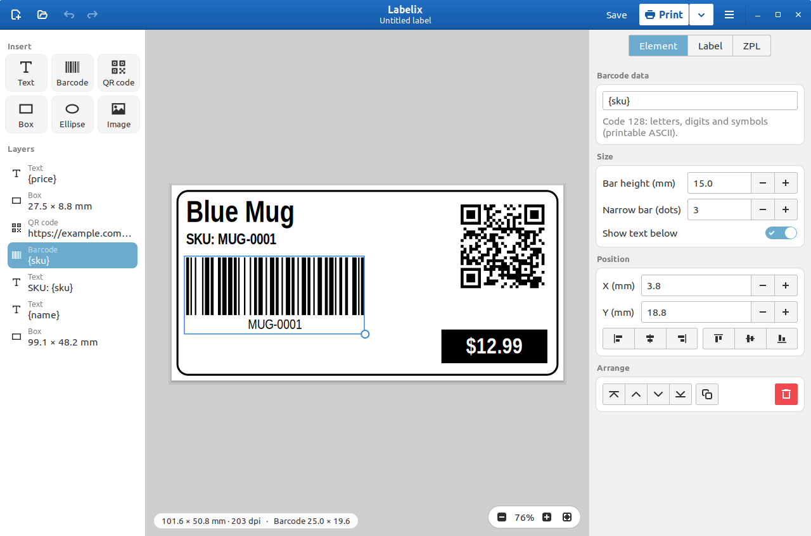
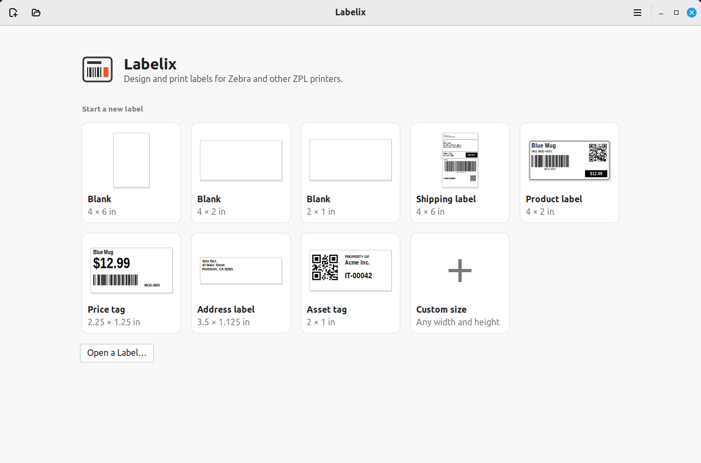
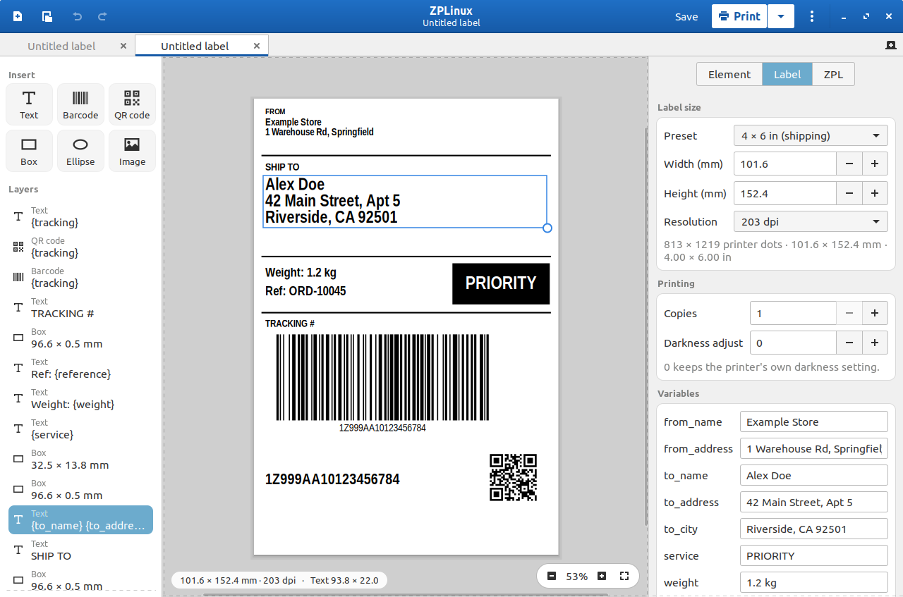
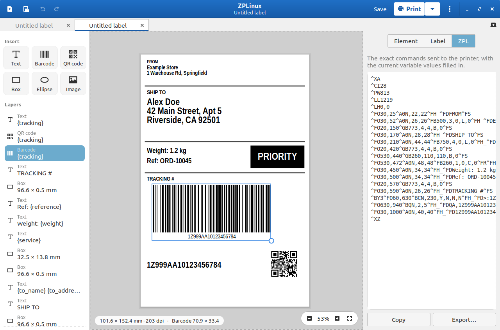

# ZPLinux

[](https://github.com/thuutien/ZPLinux/releases/latest)

A WYSIWYG label designer for **Zebra and other ZPL thermal printers** on Linux,
built with Python + GTK3. Zebra's own ZebraDesigner only runs on Windows;
ZPLinux designs labels on any Linux desktop and sends real ZPL to the printer.

> ZPLinux was called **Labelix** up to version 0.4.2. Labelix can't update itself
> to ZPLinux: install ZPLinux from the [releases page](https://github.com/thuutien/ZPLinux/releases/latest)
> (the `.deb` replaces the Labelix package). Your printers and recent files carry
> over, and `.labelix` files still open.

<p align="center">
  
</p>

<p align="center">
  
  
  
</p>

## Features

- **Start screen** with ready-made templates (shipping, product, price tag,
  address, asset tag, blank sizes), **your own templates** (menu → Save as
  Template; right-click one to delete it) and your recent labels
- **Tabs**: open and edit several labels at once, each with its own undo
  history and zoom (Ctrl+T new, Ctrl+W close, Ctrl+PageUp/PageDown to switch)
- **Canvas**: text, barcodes, QR codes, boxes/lines, ellipses and images
  (converted to 1-bit for thermal printing). Drag to move, drag the round
  handle to resize, double-click to edit content, right-click for more
- **29 barcode types**, picked from the **Type** list of a barcode:
  - 1D: Code 128, GS1-128, Code 39, Code 93, EAN-13, EAN-8, UPC-A, UPC-E,
    UPC/EAN extension, GS1 DataBar, Interleaved 2 of 5
  - 2D: QR code, Data Matrix, GS1 DataMatrix, PDF417, MicroPDF417, Aztec,
    MaxiCode, Codablock F
  - Postal and legacy: Codabar, Code 11, Code 49, Industrial 2 of 5,
    Standard 2 of 5, LOGMARS, MSI, Plessey, Planet, POSTNET
- **Smart guides**: elements snap to the label's edges and centre and to each
  other (hold Alt to place freely); optional 5 mm grid. Turn the grid and
  snapping on and off with the two buttons next to Undo/Redo in the top bar
- **Work area around the label**: drag objects partly or wholly off the label
  (they show faded there). Only what is on the label prints; a part hanging off
  the left or top edge is sent as a graphic, since printers can't place fields
  there
- **Layers list** to pick overlapping elements, plus align and arrange buttons
- **Select several objects**: Shift-click, drag a box on empty space, or Ctrl+A;
  then move, nudge, align (to each other), rotate, duplicate or delete them
  together
- **Printer fonts**: besides the scalable font 0, text can use the fonts built into
  Zebra printers (A–H, including OCR-A and OCR-B). They come in whole-step sizes,
  and the preview spaces, wraps and centres them exactly as the printer does
- **Rotation**: turn text, barcodes and images by 90° steps (Ctrl+R, or the
  Rotation setting); boxes and ellipses swap width and height. QR codes and
  MaxiCode print upright, as printers draw them
- **Rotate when printing** (Label tab): design a label one way and print it
  turned onto stock that feeds the other way, such as a 6 × 4 in landscape
  design on 4 × 6 in labels
- Work in **millimetres, inches or printer dots** (Preferences); 203 / 300 /
  600 dpi; label size presets (4×6, 4×2, 2×1 in…)
- Live ZPL view with copy and export
- **Variables**: type `{name}` in any text, barcode or QR field, fill it in on
  the Label tab, or **print a batch from a CSV, Excel (.xlsx) or LibreOffice (.ods) file** whose column headers match
- **Date, time and counter**: `{date}`, `{time}` and `{counter}` fill in when the
  label prints (formats, start, step and zero padding on the Label tab); the
  counter goes up for every label, copies and CSV batches included
- Print over the network (TCP 9100), straight to a USB printer (`/dev/usb/lp0`),
  through a raw CUPS queue, or to a `.zpl` file
- **Printer checks**: before printing to a network or USB printer, ZPLinux asks
  it for its model and status and warns when it is out of labels, open, set to a
  different resolution, or narrower than the label. **Check Printer** shows the
  model and status; **Calibrate Label Stock** measures new labels
- **Import ZPL**: open `.prn` / `.zpl` files, such as ZebraDesigner's "print to
  file" output, as editable labels
- Drop images, `.zplinux` or ZPL files onto the window
- Undo/redo, keyboard shortcuts (Ctrl+? lists them), light and dark themes
- **Update check**: looks for new GitHub releases once a day (can be turned off
  in Preferences) and can download, verify and install them for you
- Labels are saved as `.zplinux` JSON files with images embedded

## Install

**Debian / Ubuntu / Mint**: install the `.deb` from the
[releases page](https://github.com/thuutien/ZPLinux/releases/latest):

```bash
sudo apt install ./zplinux_0.6.1_all.deb
```

**Flatpak (any distribution)**: download `zplinux-0.6.1.flatpak` from the
releases page and install it for your user. Flatpak fetches the GNOME runtime
from Flathub if you don't have it yet:

```bash
flatpak install --user ./zplinux-0.6.1.flatpak
```

The Flatpak can reach network printers, USB printers (`/dev/usb/lp*`), CUPS
and your home folder. To build it yourself, run `packaging/build-flatpak.sh`.

**Arch / Manjaro**: build from `packaging/arch/PKGBUILD` with `makepkg -si`.

**Any distribution**: extract the release archive and run:

```bash
sudo ./install.sh
```

Uninstall with `sudo ./install.sh --uninstall`. Installing also adds the
`zplinux-fake-printer` command (see below) and makes `.zplinux` files open in
ZPLinux.

### Updates

ZPLinux asks GitHub for the latest release at most once a day (turn this off
in Preferences, or use **Check for Updates** in the menu). When a newer version
exists, a bar at the top of the window offers to install it:

- **.deb and `install.sh` installs**: ZPLinux downloads the matching release
  file, checks it against the SHA-256 checksum GitHub publishes, and installs
  it with `pkexec` (you'll be asked for your password), then offers to restart.
- **AUR / other package managers**: update through the package manager.
- **Flatpak**: the bar links to the release page; install the new
  `.flatpak` file the same way as the first one.
- **Running from source**: the bar links to the release page.

For this to work, each GitHub release (tag `v<version>`) needs
`zplinux_<version>_all.deb` and `zplinux-<version>.tar.gz` attached.

### Building the packages

```bash
./packaging/build-tarball.sh   # dist/zplinux-<version>.tar.gz (prints its sha256)
./packaging/build-deb.sh       # dist/zplinux_<version>_all.deb
./packaging/build-flatpak.sh   # dist/zplinux-<version>.flatpak (needs flatpak-builder)
```

The PKGBUILD downloads `zplinux-<version>.tar.gz` from the GitHub release
`v<version>`. After uploading it, put the checksum from `build-tarball.sh` in
`sha256sums`, run `makepkg --printsrcinfo > .SRCINFO`, and push both to the AUR.

## Run from source

Needs Python 3, PyGObject and GTK 3 (preinstalled on most desktops).
Optional, for the preview only: `python3-qrcode` draws QR codes and `zint`
draws the barcode types other than Code 128 and QR. Labels print the same
without them.

```bash
python3 zplinux.py
```

Open the example: `python3 zplinux.py examples/product.zplinux`

### Dependencies by distribution

| Distribution | Command |
| --- | --- |
| Debian / Ubuntu / Mint | `sudo apt install python3-gi gir1.2-gtk-3.0 python3-qrcode zint` |
| Fedora | `sudo dnf install python3-gobject gtk3 python3-qrcode zint` |
| Arch / Manjaro | `sudo pacman -S python-gobject gtk3 python-qrcode zint` |

## Testing without a printer

`tools/fake_printer.py` pretends to be a networked Zebra printer. It listens
on port 9100 and saves every job it receives into `received/`:

```bash
python3 tools/fake_printer.py --render     # or, when installed: zplinux-fake-printer --render
```

With `--render` it also sends each job to the free
[Labelary](https://labelary.com) online renderer and saves a PNG of what a
real printer would print (use `--dpmm 12` for 300 dpi and `--size 4x2` for the
label size in inches). Leave `--render` off to keep everything offline.

In ZPLinux, the default printer is already `127.0.0.1:9100`, so pressing
**Print** sends the job to the fake printer.

You can also paste the ZPL from the ZPL tab into the
[Labelary viewer](https://labelary.com/viewer.html).

## Connecting a real printer

Open **Printers…** (in the menu next to Print) to add as many printers as you
like, give each a name, and mark one as the **default**. ZPLinux prints to the
default printer; the menu next to Print lets you pick another one for this
session. Each printer connects in one of these ways:

- **Network**: the printer's IP address, port 9100.
- **USB device file**: usually `/dev/usb/lp0`. Your user needs to be in the
  `lp` group: `sudo usermod -aG lp $USER`, then log out and back in.
- **CUPS printer (raw)**: add the printer in CUPS as a *Raw* queue (no driver)
  so the ZPL reaches it unchanged; ZPLinux sends with `lp -o raw`.

## Importing from ZebraDesigner

ZPLinux can't read ZebraDesigner's `.nlbl` files, but it can import the ZPL
that ZebraDesigner sends to the printer:

1. In ZebraDesigner, print the label to a file instead of to the printer.
   This saves the ZPL as a `.prn` file.
2. In ZPLinux, **Open** the `.prn` file (or drop it onto the window). It opens
   in a new tab as an unsaved label; save it as a `.zplinux` file.

Text, barcodes of every type in the list above, boxes, lines, ellipses and
graphics come back as editable elements. Some things change, and ZPLinux lists them after the import
(the **Details** button):

- Printer fonts other than font 0 and TrueType fonts become font 0 at the same size.
- Rotated text and barcodes come in upright.
- TLC39 barcodes, which ZPLinux doesn't make, become Code 128.
- Variables come in as the sample values ZebraDesigner printed; numbered
  fields (`^FN`) become variables named `field1`, `field2` ...
- ZPL doesn't say the printer's resolution, so ZPLinux assumes 203 dpi (as on
  a GK420d) unless the label is wider than 4.1 inches. Change it on the Label tab.

## How the preview relates to the printer

The canvas draws each element the way the printer will: Code 128 barcodes pack
runs of digits in pairs (subset C, as ZebraDesigner does) and the ZPL names
the subsets explicitly, so the bars on screen are the bars on the label. Text
uses a narrow sans font in
place of Zebra font 0 (CG Triumvirate Bold Condensed). The output has been
checked against Labelary's renderer; text widths can still differ by a few
percent, so leave some room at the label edges.

The other barcode types are drawn with [zint](https://zint.org.uk/), scaled to
the printer's dots: wide bars follow the ^BY ratio, and the sizes printers
choose on their own (PDF417 columns, MicroPDF417 and Codablock layouts) are
written into the ZPL so the label matches the preview. Checked against
Labelary for every type it draws, the bars match pixel for pixel except
Plessey's stop bar (2 dots) and MaxiCode's hexagon outlines. Labelary does not
draw Codablock, Code 49 or MicroPDF417; those follow Zebra's ZPL manual.

## Tests

```bash
python3 -m unittest discover tests
```

## Project layout

```
zplinux/model.py     label and element data, units, JSON, {variables}
zplinux/zpl.py       ZPL generation
zplinux/render.py    Cairo preview rendering
zplinux/barcode.py   Code 128 / QR encoders for the preview
zplinux/symbology.py the other barcode types: ZPL commands and zint settings
zplinux/zint.py      runs zint for the preview of those types
zplinux/printing.py  network / USB / CUPS / file output
zplinux/templates.py templates on the start screen
zplinux/updater.py   GitHub release check and self-update
zplinux/canvas.py    design surface: selection, dragging, snapping
zplinux/widgets.py   property cards, toasts, CSS
zplinux/app.py       main window
data/icons/          ZPLinux's own symbolic icons
tools/fake_printer.py  stand-in printer for testing
```
